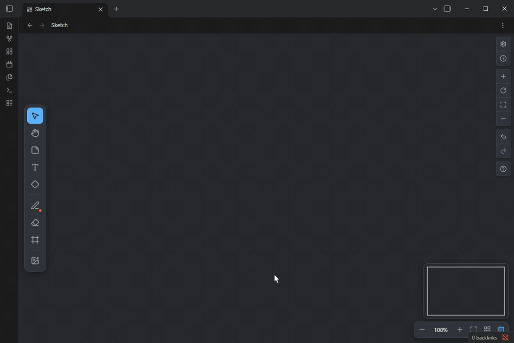
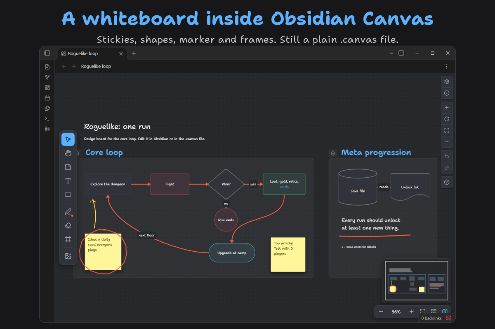
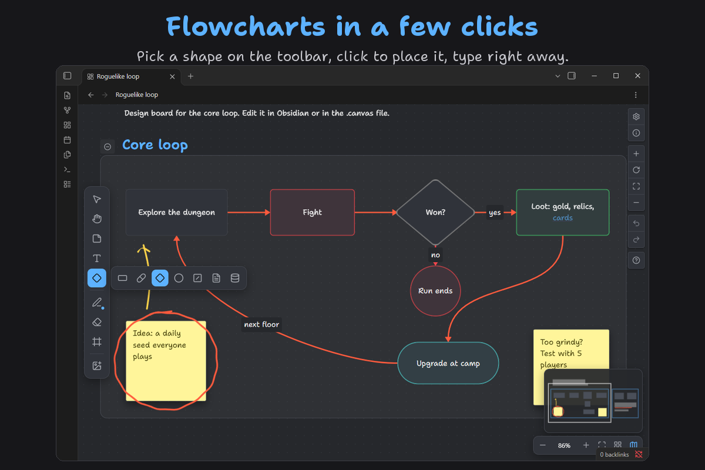
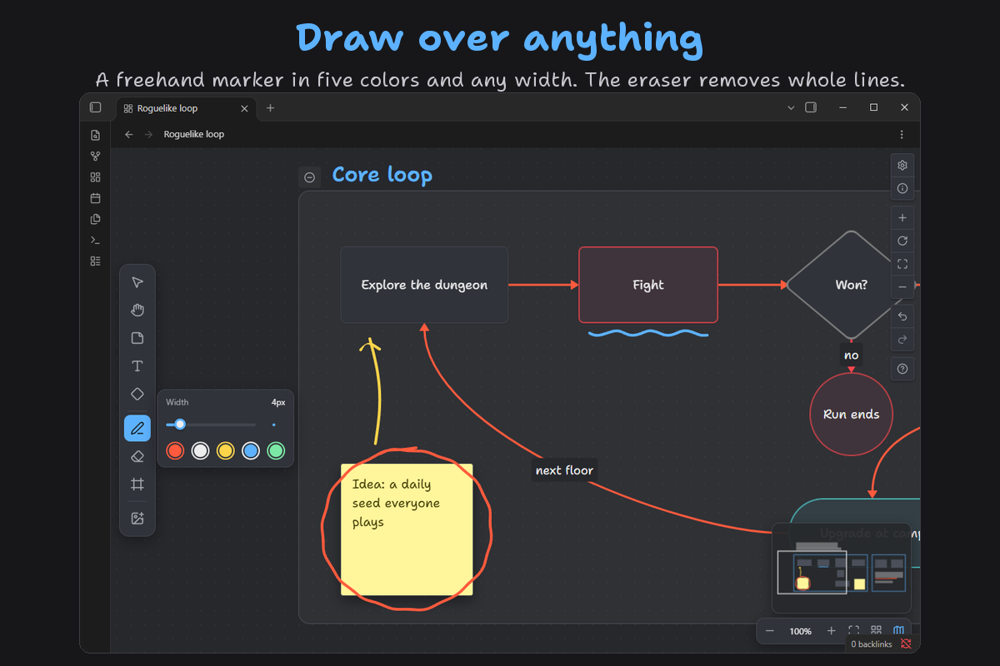
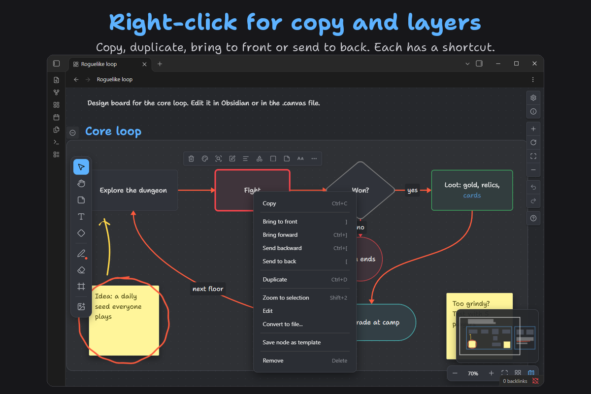

# Cult Canvas

**English** · [Русский](README.ru.md)

**Turn Obsidian canvases into a whiteboard.** Sticky notes, shapes, a freehand marker, frames, layers and a minimap on top of the core Canvas. Your boards stay plain `.canvas` files with working `[[links]]`.

[Install](#install) · [Shortcuts](#shortcuts) · [Full guide](docs/guide.md) · [Feedback](#feedback) · [Releases](https://github.com/Saneety/cult-canvas/releases)

## What you get

- **A toolbar with one-key tools**: Select `V`, Hand `H`, Sticky note `S`, Text `T`, Shape `R`, Marker `P`, Eraser `E`, Frame `F`, Image or note `I`.
- **Click to place, type right away**: sticky notes, borderless text and seven shapes (rectangle, oval, diamond, circle, parallelogram, document, database).
- **A freehand marker** in five colors, 1 to 30 px wide, to circle, underline and point. The eraser removes whole lines.
- **Frames** with titles split the board into parts.
- **Copies and layers**: Alt+drag leaves the original and moves a copy, Ctrl+D duplicates, `]` and `[` bring to front and send to back.
- **A right-click menu** with copy, layers, duplicate and delete, shortcuts shown.
- **Your last style becomes the default**: make one arrow square and the next ones come out square.
- **The selection box catches arrows** too, even when both ends are outside it.
- **A minimap**, zoom buttons and a snap-to-grid switch.
- **A handwritten font** (Shantell Sans, Latin and Cyrillic) built in, nothing to install.
- **English and Russian** interface.

## Install

Cult Canvas needs the [Advanced Canvas](https://github.com/Developer-Mike/obsidian-advanced-canvas) plugin: it provides the shapes and card styles Cult Canvas builds on.

1. In **Settings → Community plugins → Browse**, install and enable **Advanced Canvas**.
2. Search for **Cult Canvas**, install and enable it.
3. Open any `.canvas` file: the toolbar is on the left.

To install by hand, download `main.js`, `manifest.json` and `styles.css` from the [latest release](https://github.com/Saneety/cult-canvas/releases/latest) into `<your vault>/.obsidian/plugins/cult-canvas/` and enable the plugin. Desktop only (Windows, macOS, Linux).

## Shortcuts

| Key | Action |
|---|---|
| `V` `H` `S` `T` `R` `P` `E` `F` `I` | tools, in the order of the toolbar |
| Esc | back to Select |
| Space + drag | pan with any tool |
| Alt + drag | move a copy, leave the original |
| Ctrl+D | duplicate |
| `]` / `[` | bring to front / send to back |
| Ctrl+] / Ctrl+[ | one layer forward / backward |
| Shift + selection box | add to the selection or take out of it |
| Ctrl+Z / Ctrl+Shift+Z | undo / redo, marker lines included |

On macOS use Cmd instead of Ctrl. Tool keys work while you are not typing in a card.

## For scripts and AI agents

A board is a [JSON Canvas](https://jsoncanvas.org) file. Cult Canvas adds only a few fields: a sticky note is a text node with `"styleAttributes": {"gbKind": "sticky"}`, a marker line is a text node with empty text and a `gbStroke` field. Obsidian picks up changes on disk while the board is open, so a script or an agent can draw on it. The whole format is in the [guide](docs/guide.md#format-for-scripts-and-agents).

## Feedback

Found a bug? [Report it](https://github.com/Saneety/cult-canvas/issues/new?template=bug_report.yml). An idea or a question? Write in [Discussions](https://github.com/Saneety/cult-canvas/discussions), where you can also upvote other people's ideas. English and Russian are both fine.

## Privacy

No network requests, accounts or telemetry. The plugin reads a file outside the vault only when you pick an image from your computer to insert, and copies that image into the vault. The font ships inside the plugin.

## License

[MIT](LICENSE) © 2026 Saneety. Includes [perfect-freehand](https://github.com/steveruizok/perfect-freehand) (MIT) and [Shantell Sans](https://github.com/arrowtype/shantell-sans) (SIL Open Font License 1.1, [OFL.txt](OFL.txt)).
