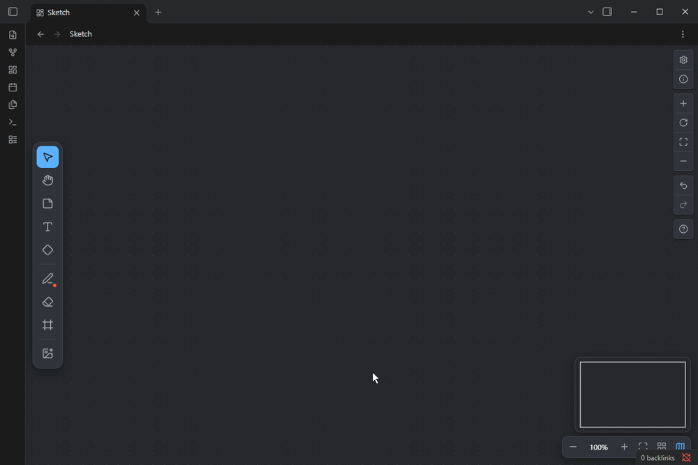
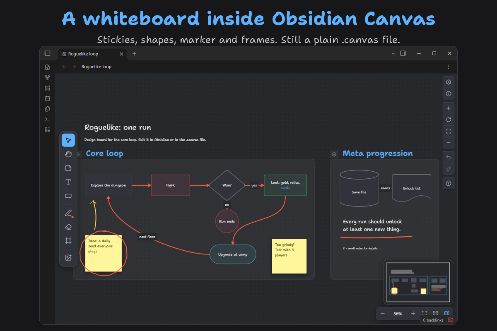
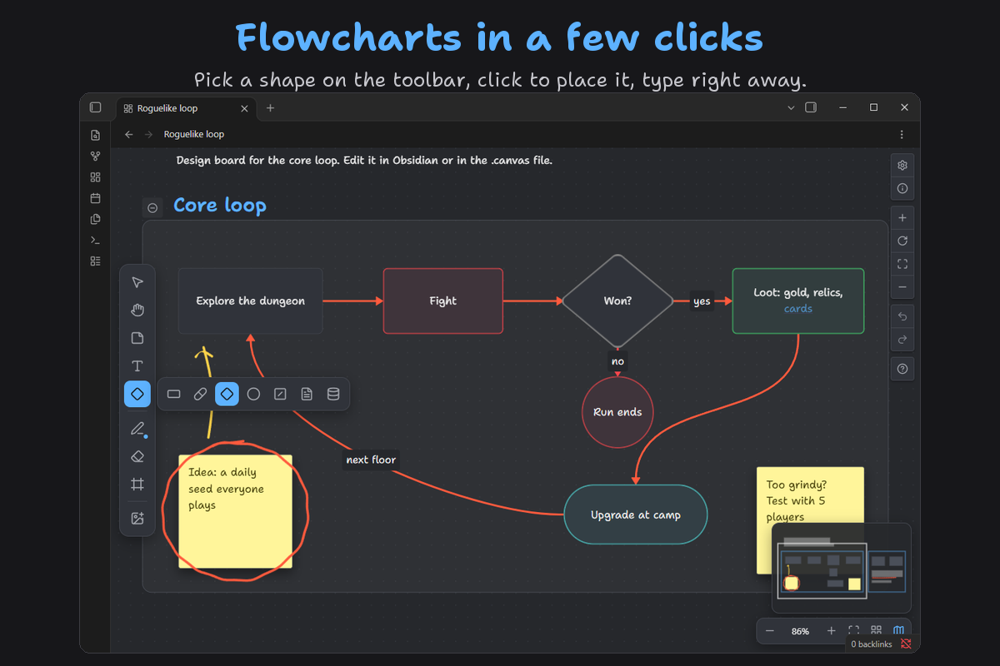
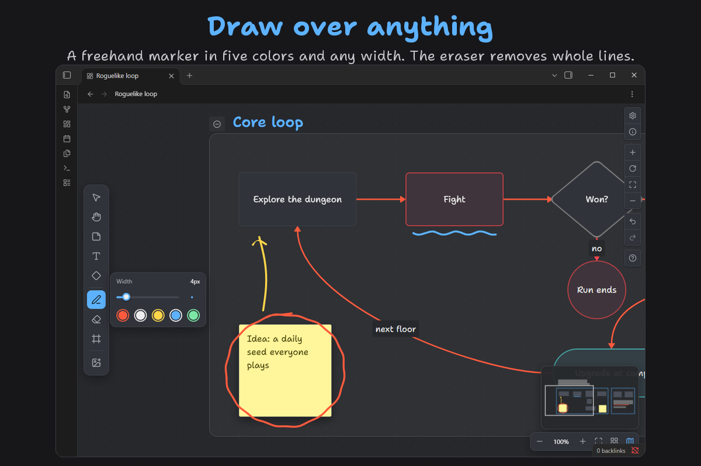
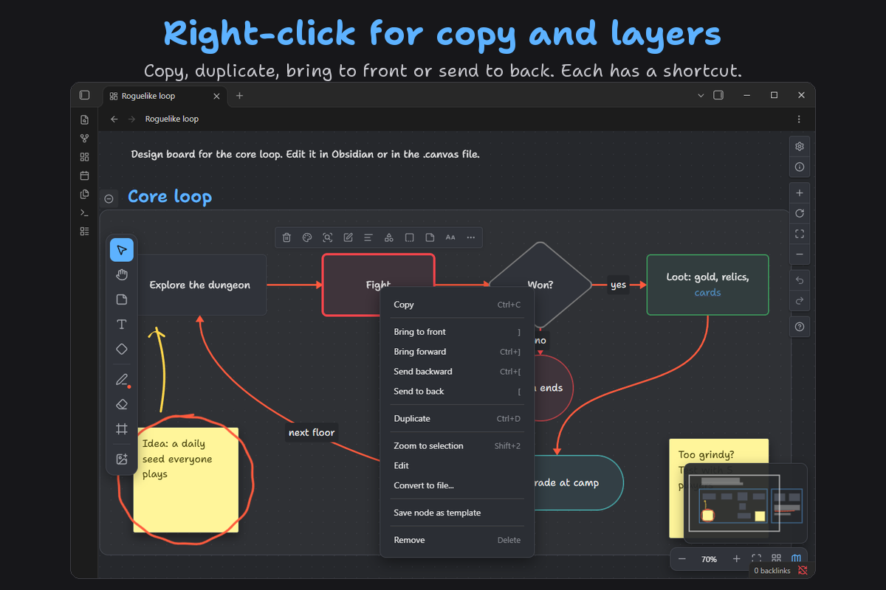

# Cult Canvas

[English](README.md) · **Русский**

**Превращает канвасы Obsidian в доску.** Стикеры, фигуры, маркер от руки, разделы, слои и миникарта поверх обычного Canvas. Доски остаются простыми файлами `.canvas`, ссылки `[[...]]` в них работают.

[Установка](#установка) · [Горячие клавиши](#горячие-клавиши) · [Подробный гайд](docs/guide.ru.md) · [Обратная связь](#обратная-связь) · [Релизы](https://github.com/Saneety/cult-canvas/releases)

## Что внутри

- **Панель инструментов, у каждого своя клавиша**: Выделение `V`, Рука `H`, Стикер `S`, Текст `T`, Фигура `R`, Маркер `P`, Ластик `E`, Раздел `F`, Картинка или заметка `I`.
- **Клик - и сразу пишешь**: стикеры, текст без рамки и семь фигур (прямоугольник, овал, ромб, круг, параллелограмм, документ, база данных).
- **Узлы на стрелках**, как в Miro: потяни ручку посередине выделенной стрелки, чтобы провести её в обход карточек.
- **Маркер от руки**: пять цветов и свои, толщина 1-30 px, чтобы обвести, подчеркнуть, показать стрелкой. Ластик стирает линию целиком.
- **Разделы** с заголовками делят доску на части.
- **Копии и слои**: Alt+перетаскивание оставляет оригинал и тянет копию, Ctrl+D дублирует, `]` и `[` выносят на передний и задний план.
- **Меню по правому клику**: копировать, слои, дублировать, удалить, с горячими клавишами.
- **Последний стиль - по умолчанию**: сделал одну стрелку квадратной, следующие сразу квадратные.
- **Рамка выделения цепляет и стрелки**, даже если оба конца снаружи.
- **Миникарта**, кнопки масштаба и привязка к сетке.
- **Рукописный шрифт** (Shantell Sans, латиница и кириллица) уже внутри, ставить ничего не надо.
- **Русский и английский** интерфейс.

## Установка

Cult Canvas работает поверх плагина [Advanced Canvas](https://github.com/Developer-Mike/obsidian-advanced-canvas): он даёт фигуры и стили карточек, на которых стоит Cult Canvas.

1. В **Настройки → Сторонние плагины → Обзор** установи и включи **Advanced Canvas**.
2. Найди **Cult Canvas**, установи и включи.
3. Открой любой `.canvas`: панель инструментов слева.

Чтобы поставить вручную, скачай `main.js`, `manifest.json` и `styles.css` из [последнего релиза](https://github.com/Saneety/cult-canvas/releases/latest) в `<хранилище>/.obsidian/plugins/cult-canvas/` и включи плагин. Язык - в настройках плагина. Только для компьютера (Windows, macOS, Linux).

## Горячие клавиши

| Клавиша | Что делает |
|---|---|
| `V` `H` `S` `T` `R` `P` `E` `F` `I` | инструменты, по порядку на панели |
| Esc | вернуться к выделению |
| Пробел + перетаскивание | тянуть доску любым инструментом |
| Alt + перетаскивание | тянуть копию, оригинал остаётся |
| Ctrl+D | дублировать |
| `]` / `[` | на передний / задний план |
| Ctrl+] / Ctrl+[ | на слой вперёд / назад |
| Shift + рамка выделения | добавить к выделению или снять |
| Ctrl+Z / Ctrl+Shift+Z | отменить / вернуть, линии маркера тоже |

На macOS вместо Ctrl - Cmd. Клавиши инструментов работают, когда ты не пишешь в карточке.

## Для скриптов и ИИ-агентов

Доска - это файл [JSON Canvas](https://jsoncanvas.org). Cult Canvas добавляет всего пару полей: стикер - текстовый узел с `"styleAttributes": {"gbKind": "sticky"}`, линия маркера - текстовый узел с пустым текстом и полем `gbStroke`. Obsidian подхватывает правку файла на диске и при открытой доске, так что скрипт или агент может рисовать на ней. Весь формат - в [гайде](docs/guide.ru.md#формат-для-скриптов-и-агентов).

## Обратная связь

Что-то сломалось? [Напиши об ошибке](https://github.com/Saneety/cult-canvas/issues/new?template=bug_report.yml). Есть идея или вопрос? Пиши в [Discussions](https://github.com/Saneety/cult-canvas/discussions), там же можно поддержать чужие идеи. Можно по-русски.

## Приватность

Без сети, аккаунтов и телеметрии. Файл вне хранилища плагин читает, только когда ты сам выбираешь картинку с компьютера для вставки, и копирует её в хранилище. Шрифт встроен в плагин.

## Лицензия

[MIT](LICENSE) © 2026 Saneety. Внутри [perfect-freehand](https://github.com/steveruizok/perfect-freehand) (MIT) и [Shantell Sans](https://github.com/arrowtype/shantell-sans) (SIL Open Font License 1.1, [OFL.txt](OFL.txt)).
