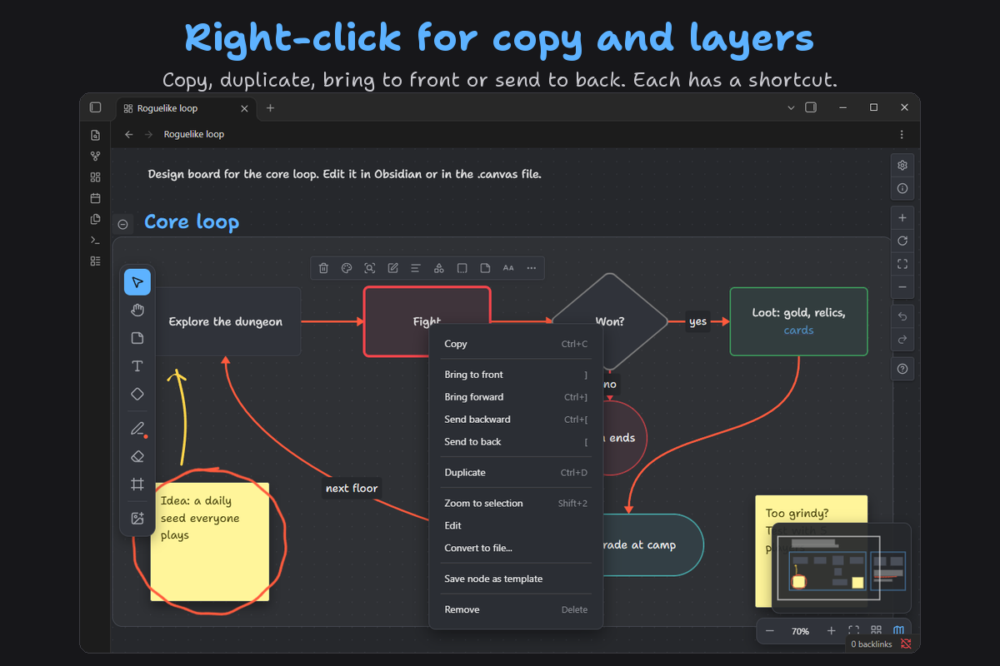

# Cult Canvas guide

Everything the plugin does, in detail. The short version is in the [README](../README.md).
[Русская версия](guide.ru.md)

- [Requirements](#requirements)
- [Tools](#tools)
- [Zoom, grid and minimap](#zoom-grid-and-minimap)
- [Selection, copies, layers](#selection-copies-layers)
- [Last style becomes the default](#last-style-becomes-the-default)
- [Context menu](#context-menu)
- [Popup over the selection](#popup-over-the-selection)
- [Links to notes](#links-to-notes)
- [Settings](#settings)
- [Format for scripts and agents](#format-for-scripts-and-agents)
- [Limitations](#limitations)
- [Development](#development)
- [Third-party code](#third-party-code)

## Requirements

- **[Advanced Canvas](https://github.com/Developer-Mike/obsidian-advanced-canvas)** (community plugin
  `advanced-canvas`, tested with 7.1.2). It provides the shapes, card styles and canvas events Cult Canvas
  builds on. Without it the toolbar still shows, but bend points on arrows, shapes, sticky notes, marker lines
  and text sizes do not work. While it is missing or turned off, a hint on top of every board says so, and its
  button installs or enables the plugin.
- Obsidian on desktop (Windows, macOS, Linux). The plugin is desktop only: copying uses the desktop
  clipboard.

The board turns on by itself on every `.canvas` file of the vault.

## Tools

The toolbar is on the left of every canvas. Hotkeys work while the cursor is not in a card's text.

| Key | Tool | What it does |
|---|---|---|
| V | Select | the usual Canvas selection: click, selection box, drag |
| H | Hand | pan the board |
| S | Sticky note | click for a 220x220 note, drag for your own size; typing starts at once |
| T | Text | text without a border; left empty, it is removed as soon as you click elsewhere |
| R | Shape | rectangle, oval, diamond, circle, parallelogram, document, database (pick it in the panel) |
| P | Marker | freehand lines; the panel has a width slider (1-30 px), 5 colors and your own colors; a line keeps one width along its length however fast you move; with Shift held the line is straight |
| E | Eraser | erases the marker lines you drag over |
| F | Frame | a section with a title (a Canvas group) |
| I | Insert | an image from your computer, an image or a note from the vault |
| Esc | | back to Select |
| Space | | hold and drag to pan with any tool |

Sticky note, Text, Shape and Frame place one element and go back to Select, so you can move it right away.

Your own marker color: press "+" in the second row of the marker panel and pick a color. The last 4 colors
you picked stay in that row, newest first.

## Zoom, grid and minimap

Bottom right: zoom (minus, percent - a click resets to 100%, plus), fit everything, snap to grid and the
minimap (click or drag it to move the board). The mouse wheel, Ctrl+Z and Ctrl+Shift+Z work as in Canvas;
marker lines are undone too.

Snapping to the grid is off by default, so cards, shapes and frames go exactly where you drag them. The grid
button (and the command "Toggle snap to grid") turns it on; it is the same setting as in the Canvas settings
menu and is shared by all canvases of the vault. Snapping to the edges of nearby cards stays (it is in the
Canvas menu as well); holding Ctrl while dragging turns both off.

## Selection, copies, layers

- A selection box (drag on an empty spot) also selects the arrows whose line it touches, even when both ends
  are outside. With Shift the box adds to the selection and removes what was already selected.
- Alt + drag leaves the original in place and drags a copy. Ctrl+D duplicates the selection next to it.
- Layers: `]` brings to front, `[` sends to back, Ctrl+] brings one layer forward, Ctrl+[ sends one layer
  backward (a step goes past the nearest element that overlaps the selection). The layer order is the order of
  nodes in the file. Dragging and selecting do not change layers, so a big background never jumps above the
  small cards on it. Frames (Canvas groups) always lie under cards: that is how Canvas draws them.
- Every layer change can be undone with Ctrl+Z.

On macOS use Cmd instead of Ctrl; Canvas itself makes a copy on Alt + drag there.

## Last style becomes the default

New elements get the style you last gave an element of the same kind: make an arrow square and the next
arrows are square too. Arrows, cards, sticky notes, borderless text, frames and every shape remember their
own style. Remembered: color, text size, alignment, border, and for arrows also the line shape, dashes and
ends; not the size or the text. Undo, paste and copies are not remembered. The memory is kept in the plugin
settings (`data.json`, field `styleDefaults`).

## Context menu

Right-click a card or an arrow, or press "..." at the end of the popup above the selection. The menu has
Copy at the top, then layers and Duplicate, then the items of Canvas and Advanced Canvas, Delete at the
bottom, with hotkeys on the right.



A card's text looks finished while you type: the same font, size, color, alignment and padding, and a
diamond stays a diamond. Entering edit mode does not flicker.

Arrows are drawn from the dots on the edges of a card; double-click an arrow to label it.

## Bend points on arrows

Select one arrow with the Select tool: a blue handle shows in the middle of each of its segments. Drag a
handle to add a bend point there and route the arrow around other cards. A bend point can be dragged; near
the line of its neighbour it snaps level or straight. Double-click a point to remove it; "Remove bend points"
in the context menu removes them all.

The arrow keeps its line shape from the Advanced Canvas popup: a curve goes smoothly through the points,
"direct" is a broken line, "square" makes right angles and enters the card straight. When you move both cards
of an arrow (dragging, arrow keys), its points move with them; copies, Ctrl+D and paste keep them too. Each
drag is one Ctrl+Z step.

A selected arrow also has round handles on its two ends: drag one to another card to reconnect the arrow.
Dropped on the empty board, the end goes back. A new arrow shows its line shape while you drag it out.

## Popup over the selection

The bar above the selection shows what fits the selected objects, and the chosen option in its lists is blue:

- shape and sticky note: type, fill, border (shape), text size, bold, alignment, list, line spacing, text
  color, highlight;
- text: the same without the border, fill at the end;
- marker line: color and thickness;
- arrow: color, line (shape, dashes, thickness), ends (direction and arrowhead);
- frame: fill and border; image, note and web page: border.

On a fill of its own the text turns dark or light by itself so it reads, and so do links. A text color you
picked stays while it reads on the new fill; otherwise changing the fill gives the text the automatic color back.

Bold, highlight and list change the whole card and are written as Markdown in its text. "..." opens the
context menu. When objects of different kinds are selected, the bar shows "Filter": pick a kind in the list to
keep only those objects selected.

## Links to notes

Any words in double square brackets in a card are a link: `Build the [[furnace]]`. The first click selects
the card, the second opens the note in the same tab (that is how Obsidian Canvas works; go back with the
back arrow). A link to a note that does not exist yet is dimmer. Restart Obsidian (Ctrl+R) once after you
first enable Advanced Canvas, so links in canvases reach backlinks and the graph.

## Settings

**Language**: English (default) or Russian, for the toolbar, the menus, the notices and the commands.

## Format for scripts and agents

A canvas is [JSON Canvas](https://jsoncanvas.org): JSON with `nodes` and `edges`. Advanced Canvas adds
`"metadata": {"version": "1.0-1.0", "frontmatter": {}}` at the root: leave it as it is. Obsidian picks up an
edit of the file on disk even while the board is open. New ids are 16 hex characters, unique in the file.

| What | Node |
|---|---|
| Card | `{"type":"text","text":"...","x","y","width","height"}` |
| Sticky note | the same + `"styleAttributes":{"gbKind":"sticky"}` |
| Text without border | `"styleAttributes":{"gbKind":"text"}` |
| Text size | `"gbFontSize":24` (pixels, 8-200) in `styleAttributes`; older boards: `"gbSize":"s"`, `"l"` or `"xl"`; no field - 18 |
| Card colors | `"gbFill"`, `"gbBorder"`, `"gbTextColor"`, `"gbHighlight"` in `styleAttributes`: `"#RRGGBB"` (`"transparent"` for no fill); with `gbFill` and no `gbTextColor` the text color is picked to read on the fill |
| Line spacing | `"gbLineHeight":1.5` in `styleAttributes` |
| Arrow thickness | `"gbWidth":5` (pixels, 1-12) in the `styleAttributes` of the edge |
| Shape | `"styleAttributes":{"shape":"diamond","textAlign":"center"}`; shapes: `pill`, `diamond`, `circle`, `parallelogram`, `document`, `database`, `predefined-process`; no `shape` - rectangle |
| Frame | `{"type":"group","label":"Act 1","x","y","width","height"}`; cards belong to it by their coordinates |
| Note, image | `{"type":"file","file":"path/in/vault.md", ...}` |
| Color | `"color":"1"`...`"6"` (the Obsidian palette) or `"#RRGGBB"` |

An arrow: `{"id","fromNode","fromSide","toNode","toSide","label":"needs"}`, sides are `top`, `right`,
`bottom`, `left`. Bend points: `"gbWaypoints":[[250,250],[550,250]]`, the points in board coordinates from the
start of the arrow to its end.

A marker line is a text node with empty text:

```json
{"id":"...","type":"text","text":"","x":94,"y":44,"width":112,"height":42,"color":"#FF5A3D",
 "gbStroke":{"v":1,"size":5,"w":112,"h":42,"points":[[6,6],[56,36],[106,6]]}}
```

`points` are the points of the line from the node's top left corner, `size` is the width in pixels (the
slider gives 1-30), `w` and `h` are the node size when the line was drawn (stretch the node and the line
stretches with it). Marker colors: `#FF5A3D`, `#EDEDED`, `#FFD54A`, `#5DB2FF`, `#7CE8A6`, or any `#RRGGBB`. Without the plugin
such a node shows as an empty card.

The `gb` prefix of these fields and of the CSS classes comes from the plugin's working name; boards already
store them, so it stays.

## Limitations

- The plugin relies on internal parts of Obsidian Canvas and Advanced Canvas that have no public API; an update
  of either can break something until the plugin is updated.
- Card text does not grow its card (resize it by hand).
- Tested on Windows. macOS, Linux and popout windows have not been tested.
- Comments, reactions, a timer, kanban and real-time collaboration are left out on purpose.

## Development

`main.js` is the source: plain CommonJS with no build step. Tests of the pure logic: `node main.test.js`
(Node 18 or later). `node scripts/install.mjs <vault>` copies the plugin into a vault for a manual check;
`scripts/fetch-font.mjs` and `scripts/embed-font.mjs` refresh the embedded font.

Releases are built by GitHub Actions. Raise the version in `manifest.json` and `versions.json`, commit, then push
an annotated tag equal to that version, its message being the release notes (`git tag -a 0.1.2 -m "..."`,
`git push origin 0.1.2`). `.github/workflows/release.yml` runs the tests, attests `main.js`, `manifest.json` and
`styles.css` and publishes the release. Check a downloaded file with
`gh attestation verify main.js --repo Saneety/cult-canvas`. Keep `!important` and `:has()` out of `styles.css`:
the plugin directory's CSS check warns about them, and a test fails on them.

The plugin makes no network requests and reads nothing outside the vault except the image files you pick to
insert. The font is embedded in `main.js`.

## Third-party code

Cult Canvas is [MIT](../LICENSE) © 2026 Saneety. Two third-party parts live inside `main.js`:

- [perfect-freehand](https://github.com/steveruizok/perfect-freehand) 1.2.3, MIT, Copyright (c) 2021 Stephen
  Ruiz Ltd, for the shape of marker lines.
- [Shantell Sans](https://github.com/arrowtype/shantell-sans), Copyright 2022 The Shantell Sans Project
  Authors, SIL Open Font License 1.1 ([OFL.txt](../OFL.txt)), embedded as latin, latin-ext and cyrillic subsets.
