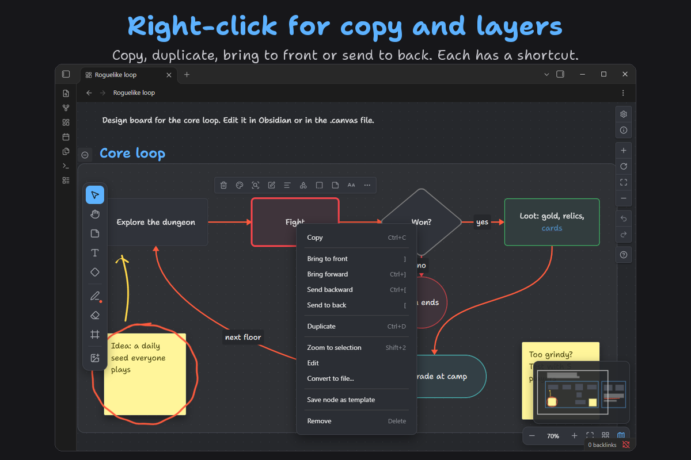

# Гайд по Cult Canvas

Всё, что умеет плагин, подробно. Коротко - в [README](../README.ru.md).
[English version](guide.md)

- [Что нужно](#что-нужно)
- [Инструменты](#инструменты)
- [Масштаб, сетка и миникарта](#масштаб-сетка-и-миникарта)
- [Выделение, копии, слои](#выделение-копии-слои)
- [Последний стиль - по умолчанию](#последний-стиль---по-умолчанию)
- [Контекстное меню](#контекстное-меню)
- [Попап карточки](#попап-карточки)
- [Ссылки на заметки](#ссылки-на-заметки)
- [Настройки](#настройки)
- [Формат для скриптов и агентов](#формат-для-скриптов-и-агентов)
- [Ограничения](#ограничения)
- [Разработка](#разработка)
- [Сторонний код](#сторонний-код)

## Что нужно

- **[Advanced Canvas](https://github.com/Developer-Mike/obsidian-advanced-canvas)** (плагин сообщества
  `advanced-canvas`, проверено на 7.1.2). Он даёт фигуры, стили карточек и события канваса, на которых
  стоит Cult Canvas. Без него панель инструментов видна, но не работают узлы на стрелках, фигуры, стикеры,
  линии маркера и размеры текста. Пока он не установлен или выключен, вверху каждой доски висит подсказка, а её
  кнопка ставит или включает плагин.
- Obsidian на компьютере (Windows, macOS, Linux). На телефоне плагин не работает: копирование идёт через
  буфер обмена компьютера.

Доска включается на любом `.canvas` хранилища сама.

## Инструменты

Панель слева на любом канвасе. Клавиши работают, когда курсор не в тексте карточки.

| Клавиша | Инструмент | Как работает |
|---|---|---|
| V | Выделение | обычный Canvas: клик, рамка выделения, перетаскивание |
| H | Рука | тянуть доску |
| S | Стикер | клик - стикер 220x220, протянуть - своего размера, сразу ввод текста |
| T | Текст | надпись без рамки |
| R | Фигура | прямоугольник, овал, ромб, круг, параллелограмм, документ, база данных (выбор в панели) |
| P | Маркер | рисовать от руки; в панели ползунок толщины 1-30 px, 5 цветов и свои цвета; линия одной толщины по всей длине, как ни веди мышь |
| E | Ластик | стирает линии маркера, по которым проведёшь |
| F | Раздел | рамка с заголовком (группа Canvas) |
| I | Вставка | картинка с компьютера, картинка или заметка из хранилища |
| Esc | | вернуться к выделению |
| Пробел | | держать и тянуть доску любым инструментом |

Стикер, Текст, Фигура и Раздел ставят один элемент и возвращают к выделению, так что его можно сразу двигать.

Свой цвет маркера: «+» во втором ряду панели маркера, затем выбрать цвет. Последние 4 выбранных цвета остаются
в этом ряду, новый - первым.

## Масштаб, сетка и миникарта

Справа внизу: масштаб (минус, процент - клик сбрасывает на 100%, плюс), «вписать всё», привязка к сетке,
миникарта (клик или протяжка двигает доску). Колесо мыши, Ctrl+Z и Ctrl+Shift+Z - как в обычном Canvas,
линии маркера тоже отменяются.

Привязка к сетке по умолчанию выключена: карточки, фигуры и разделы ставятся ровно туда, куда их тянешь.
Кнопка с сеткой (и команда «Привязка к сетке: вкл/выкл») включает её; это та же настройка, что в меню
настроек самого Canvas, она общая для всех канвасов хранилища. Прилипание к краям соседних карточек остаётся
(оно тоже в меню Canvas); Ctrl во время перетаскивания отключает обе привязки.

## Выделение, копии, слои

- Рамка выделения (тянуть по пустому месту) выделяет и стрелки, линию которых задела рамка, даже если концы
  стрелки снаружи. С Shift рамка добавляет к выделению и снимает выделение с того, что уже выделено.
- Alt + перетаскивание: оригинал остаётся на месте, за курсором едет копия. Ctrl+D - копия выделенного рядом.
- Слои: `]` - на передний план, `[` - на задний, Ctrl+] - на слой вперёд, Ctrl+[ - на слой назад (шаг -
  мимо ближайшего элемента, который накрывает выделенное). Порядок слоёв - порядок узлов в файле; простое
  перетаскивание и выделение слой не меняют, так что большой фон не вылезает поверх мелких карточек. Разделы
  (группы Canvas) всегда лежат под карточками: так их рисует Canvas.
- Каждое действие со слоями отменяется Ctrl+Z.

На macOS вместо Ctrl - Cmd; копию при перетаскивании там и так делает Alt в самом Canvas.

## Последний стиль - по умолчанию

Стиль, который ты последним поставил элементу, получают новые элементы того же вида: сделал стрелку
квадратной - следующие стрелки сразу квадратные. Память своя у стрелок, карточек, стикеров, текста без рамки,
разделов и у каждой формы фигуры. Запоминаются цвет, размер текста, выравнивание, рамка, у стрелок ещё форма
линии, пунктир и концы; размер и текст - нет. Отмена, вставка и копии стиль не запоминают. Память лежит в
настройках плагина (`data.json`, поле `styleDefaults`).

## Контекстное меню

ПКМ по карточке или стрелке, или кнопка «...» в конце попапа над выделенным. Сверху «Копировать», потом слои
и «Дублировать», ниже пункты Canvas и Advanced Canvas, внизу «Удалить»; справа у пунктов горячие клавиши.



Текст карточки при вводе сразу выглядит как готовый: тот же шрифт, размер, цвет, выравнивание и отступы,
ромб остаётся ромбом. Вход в правку не мигает.

Стрелки тянутся из точек на краях карточки, подпись - двойной клик по стрелке.

## Узлы на стрелках

Выдели одну стрелку инструментом выделения: посередине каждого её отрезка появится синяя ручка. Потяни
ручку - там появится узел, и стрелку можно провести в обход других карточек. Узел тоже можно тянуть; рядом с линией
соседа он прилипает ровно по горизонтали или вертикали. Двойной клик по узлу убирает его, пункт «Убрать узлы»
в контекстном меню убирает все.

Форма линии из попапа Advanced Canvas сохраняется: кривая плавно проходит через узлы, «direct» - ломаная,
«square» - прямые углы и вход в карточку под прямым углом. Когда двигаешь обе карточки стрелки
(перетаскиванием или стрелками клавиатуры), узлы едут вместе с ними; копии, Ctrl+D и вставка их тоже
сохраняют. Каждое перетаскивание - один шаг Ctrl+Z.

## Попап карточки

У выделенной карточки над ней есть кнопки Advanced Canvas и две кнопки Cult Canvas:

- «Card type» (вид карточки): карточка, стикер, текст без рамки;
- «Text size» (размер текста): S, M, L, XL.

Подписи этих двух кнопок английские, как и у остальных кнопок попапа Advanced Canvas: каталог плагинов
запрещает плагину добавлять свои стили на страницу, а сам Advanced Canvas переводов не имеет.

Цвет из стандартной кнопки красит стикер, текст без рамки, рамку фигуры и линию маркера.

## Ссылки на заметки

Любое слово в карточке в двойных квадратных скобках - ссылка: `Построить [[furnace]]`. Первый клик выделяет
карточку, второй открывает заметку в этой вкладке (так устроен Canvas Obsidian; вернуться - стрелка «назад»).
Ссылка на ещё не созданную заметку бледнее. После первого включения Advanced Canvas перезапусти Obsidian
(Ctrl+R), чтобы ссылки из канвасов попали в обратные ссылки и граф.

## Настройки

**Язык**: английский (по умолчанию) или русский - для панели инструментов, меню, уведомлений и команд.

## Формат для скриптов и агентов

Канвас - [JSON Canvas](https://jsoncanvas.org): JSON с `nodes` и `edges`. Advanced Canvas дописывает в корень
`"metadata": {"version": "1.0-1.0", "frontmatter": {}}`, его не трогать. Obsidian подхватывает правку файла
на диске и при открытой доске; новые id - 16 hex-символов, уникальные в файле.

| Что | Узел |
|---|---|
| Карточка | `{"type":"text","text":"...","x","y","width","height"}` |
| Стикер | то же + `"styleAttributes":{"gbKind":"sticky"}` |
| Текст без рамки | `"styleAttributes":{"gbKind":"text"}` |
| Размер текста | `"gbSize":"s"`, `"l"` или `"xl"` в `styleAttributes` (нет поля - M) |
| Фигура | `"styleAttributes":{"shape":"diamond","textAlign":"center"}`; формы: `pill`, `diamond`, `circle`, `parallelogram`, `document`, `database`, `predefined-process`; без `shape` - прямоугольник |
| Раздел | `{"type":"group","label":"Акт 1","x","y","width","height"}`; карточки внутри по координатам |
| Заметка, картинка | `{"type":"file","file":"путь/в/хранилище.md", ...}` |
| Цвет | `"color":"1"`...`"6"` (палитра Obsidian) или `"#RRGGBB"` |

Стрелка: `{"id","fromNode","fromSide","toNode","toSide","label":"требует"}`, стороны - `top`, `right`,
`bottom`, `left`. Узлы: `"gbWaypoints":[[250,250],[550,250]]` - точки в координатах доски от начала стрелки к
концу.

Линия маркера - текстовый узел с пустым текстом:

```json
{"id":"...","type":"text","text":"","x":94,"y":44,"width":112,"height":42,"color":"#FF5A3D",
 "gbStroke":{"v":1,"size":5,"w":112,"h":42,"points":[[6,6],[56,36],[106,6]]}}
```

`points` - точки линии от левого верхнего угла узла, `size` - толщина в пикселях (ползунок даёт 1-30), `w`
и `h` - размер узла, когда линия нарисована (если узел растянуть, линия растянется вместе с ним). Цвета
маркера: `#FF5A3D`, `#EDEDED`, `#FFD54A`, `#5DB2FF`, `#7CE8A6` или любой `#RRGGBB`. Без плагина такой узел виден как пустая
карточка.

Приставка `gb` у этих полей и у CSS-классов - от рабочего названия плагина; в досках она уже записана,
поэтому осталась.

## Ограничения

- Плагин опирается на внутренние части Canvas Obsidian и Advanced Canvas без публичного API: обновление
  любого из них может что-то сломать до обновления плагина.
- Текст карточки не растягивает её сам (растянуть рукой).
- Проверено на Windows; macOS, Linux и отдельные окна Obsidian не проверялись.
- Комментарии, реакции, таймер, канбан и совместная работа не делались намеренно.

## Разработка

`main.js` - исходник, обычный CommonJS без сборки. Проверки чистой логики: `node main.test.js` (Node 18 и
новее). `node scripts/install.mjs <хранилище>` копирует плагин в хранилище для ручной проверки;
`scripts/fetch-font.mjs` и `scripts/embed-font.mjs` обновляют встроенный шрифт.

Релизы собирает GitHub Actions. Подними версию в `manifest.json` и `versions.json`, закоммить и запушь
аннотированный тег с этой версией, его текст станет заметками релиза (`git tag -a 0.1.2 -m "..."`,
`git push origin 0.1.2`). `.github/workflows/release.yml` прогоняет проверки, подписывает аттестацией `main.js`,
`manifest.json` и `styles.css` и публикует релиз. Скачанный файл проверяется командой
`gh attestation verify main.js --repo Saneety/cult-canvas`. В `styles.css` не должно быть `!important` и
`:has()`: на них ругается проверка CSS в каталоге плагинов, и падает тест.

Плагин не ходит в сеть и вне хранилища читает только картинки, которые ты сам выбрал для вставки. Шрифт
встроен в `main.js`.

## Сторонний код

Cult Canvas - [MIT](../LICENSE) © 2026 Saneety. Внутри `main.js` две сторонние части:

- [perfect-freehand](https://github.com/steveruizok/perfect-freehand) 1.2.3, MIT, Copyright (c) 2021 Stephen
  Ruiz Ltd - форма линий маркера.
- [Shantell Sans](https://github.com/arrowtype/shantell-sans), Copyright 2022 The Shantell Sans Project
  Authors, SIL Open Font License 1.1 ([OFL.txt](../OFL.txt)), встроен подмножествами latin, latin-ext и
  cyrillic.
